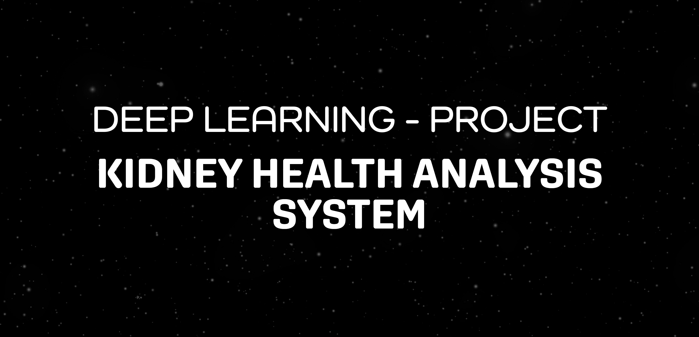

# Kidney Health Analysis System

A Deep Learning-based, end-to-end Kidney Health Analysis System designed to analyze kidney-related data and predict potential kidney diseases. Built using Python and TensorFlow, with DVC for data versioning, MLflow for experiment tracking, and AWS for cloud storage and deployment.

